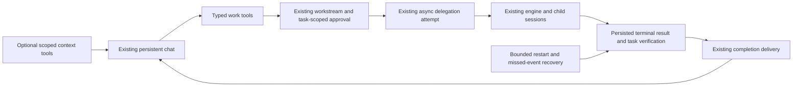

# Coordinator simplification: implementation and proof of concept

## Status and user decisions

Planning only. No implementation, live configuration change, merge, installation, or deployment has been performed or authorized by this document.

AJ selected the first proof on October 8: **complete a small coding task, verify the actual change, and return the result to the originating desktop conversation**. Prove the same conversation on phone after desktop acceptance. Preserve cross-day continuity, bounded delegated work, meaningful approvals, and truthful status.

This is a staged replacement of the Coordinator control layer. The proof must use the intended replacement path; it must not become a third permanent workflow implementation.

## Intent and constraints

**Goal:** make one persistent Coordinator conversation reliably capture work, delegate it within current authority, verify its result, and bring that result back to the same conversation across interruptions and restarts.

**In scope:** ordinary chat with structured work tools; existing durable workstreams and async delegation; task-scoped authorization; one terminal-result and callback path; task-specific verification; optional context; migration and removal of superseded Coordinator paths; desktop proof followed by mobile parity.

**Non-goals:** a new agent engine, scheduler, broker, workflow DSL, generic event-sourcing framework, replacement memory/router platform, new standalone dashboard, automatic deployment, or rewriting native engine task execution. The existing selected-reference summary recipe may remain available independently; it will not define general coding completion.

**Hard constraints:** preserve user data and unrelated dirty work; additive migrations; local agent execution remains local; owner/project isolation, current permissions, replay protection, cancellation, uncertain transport, and usage accounting remain enforced. Use only `tools/dev/sandbox.sh` for live backend proof, with sanitized fixtures and isolated ports. Never attach test services to the normal engine. Source/CI, real-model sandbox, signed desktop, and physical-phone evidence are separate claims.

**Design tensions:** fewer authoritative records versus reliable restart recovery; useful partial context versus preventing reuse of revoked data; conversational flexibility versus explicit authorization; reusing old storage versus preventing old and new workers from owning the same run.

**Cheapest useful proof:** one ordinary desktop chat, a disposable coding repository, one async Coding Agent, independent executable checks, and one visible result in that same chat. Exercise transport faults with deterministic tests before spending real-model turns.

## Clarification interview

Completed October 8 using two optional choices. AJ chose the coding task proof and desktop-first acceptance, followed by the same conversation on phone. The remaining baseline, packaging, and schema checks below are implementation preconditions, not unresolved product preferences.

## Source baseline and prerequisite work

- The primary checkout was `18705742`, with unrelated memory changes; it is not the Coordinator implementation baseline.
- Reviewed integration reference: `3f5f4e9c`; the October 8 audit associates the observed desktop with product `237f54db`.
- Reviewed repair reference: `a2cfd75e` (PR #1610), based on `f6372762`; relevant product changes include `30f51138` and `31477c8b`.
- October 8 admission/memory/router work in `scheduled-dayflow-memory-router-20261008` was uncommitted when reviewed. It is not merged or release-qualified evidence.

Before coding, freeze an exact reviewed base and its source/build identity. Follow the repository's feature-branch-from-main policy. If required Coordinator prerequisites remain only on an unmerged integration branch, document that dependency and obtain an explicitly authorized stacked base or wait for the prerequisite merge; do not silently include the entire integration branch. Preserve already-fixed permission routing/acknowledgement, truthful provider errors, session model binding, and zero-exposure admission as applicable. Reconcile overlapping admission repairs into one implementation with their negative tests.

Record the actual desktop bundle, API/database, engine, and paired mobile protocol/build through read-only inspection. Repository guidance still names Flutter as shipping while recent receipts describe Electron candidates. Do not infer a client cutover from either label. The POC runs in the actual selected desktop client with an isolated backend; a browser-only harness does not satisfy desktop acceptance.

## Target architecture



### Ownership: one authoritative record for each fact

| Fact | Authority to reuse | Change / restriction |
| --- | --- | --- |
| Conversation and transcript | `agent_sessions`, `agent_session_messages` | The persistent root identifies a conversation, not a single execution. Stop duplicating normal turns in `coordinator_conversation_json.commandDedupe`. Preserve transport idempotency using durable message/request identities. |
| Work objective, criteria and human control | `agent_workstreams` | Capture objective, scope, acceptance checks and origin chat. Retain existing create-key deduplication and per-work revision. Runtime display derives from the active attempt; do not mirror every execution transition into a second authoritative status. |
| New managed execution attempt | `agent_async_delegations` | Bind it to workstream, origin chat, approved terms and unique operation key before engine side effects. Persist dispatch identity and acceptance evidence. Reuse the existing delegation service and child session creation. |
| Authorization | `agent_approvals` plus current owner/project/profile policy | Bind immutable work terms and relevant authorization revision. Consume a required approval atomically with initial attempt reservation. Existing clean-session permission does not automatically constitute budget/proposal approval. |
| Native descendants | Existing engine and local session parent links | Native `task` children belong to their admitted async attempt. Preserve their identity, restrictions, usage and cancellation. Do not invent another Coordinator attempt for each native child. |
| Execution result | Exact attempt's persisted engine turn and terminal facts | Child final prose is evidence to inspect, not proof that acceptance criteria passed. Do not use one root-level `agent_run_outcomes` row as the per-task result for a permanent chat. |
| Verification | Small versioned receipt attached to that attempt | Bind exact artifact revision, check commands/results and verifier provenance. No generic verifier framework or second execution ledger. |
| Return delivery | Existing `AsyncDelegationCompletionService` and stable callback message identity | Only the admitted top-level attempt's final result goes to its originating Coordinator root. Nested async results still return to their immediate manager; native tasks retain native completion. Reuse claiming, serialization and recovery. `notified` means transport accepted, not necessarily that a human saw a verified answer. |

Legacy `agent_bridge_jobs` remain authoritative for already-admitted legacy finite/native work. New async work must not create an additional bridge-job copy. Do not overload `agent_workstreams.lastJobId`, whose existing meaning is a bridge job; use an explicit async association.

The first schema patch should add only fields/indexes that establish these bindings. Prefer allocating a local child session identity and reserving the attempt before SDK creation; SDK allocation is itself a recoverable side effect. Specify how existing non-null child IDs and constrained statuses are handled before coding. Do not label a merely reserved attempt as accepted/dispatched. If existing storage cannot express reservation without a rebuild, isolate and review the compatibility migration; do not hide it behind a new parallel job table.

### Conversation and work tools

Route normal user language through the ordinary foreground model transport. Give the model structured operations to capture/propose work, start authorized work, inspect status, and cancel. Reuse existing Coordinator status/start and approval tools where their contracts fit; version changed contracts explicitly and add only the missing capture/proposal/cancel capability. Keep the selected-reference-specific tools scoped to their existing recipe during migration.

The server resolves authenticated owner, project, originating chat, permitted target profile, working directory and current tool scope. The model supplies a proposed objective and structured terms, never an arbitrary callback target, caller identity, bearer, permission bypass, or approval signature. Goal capture alone authorizes nothing. Free-form status questions use the same conversation path; explicit controls may call read APIs directly. Remove natural-language regex goal admission and legacy capture fallback for new-version roots once typed capture is proven.

A work proposal contains objective, repository/worktree scope, allowed effects, exclusions, acceptance checks, chosen execution policy/model, expiry, and bounded attempts/time/spend. A required human decision is bound to those terms. Adding an unrelated goal or asking for status cannot invalidate it. Changes to the objective, authorized files/effects, owner, project, relevant permissions, or binding model policy require revalidation and, when material, a revised proposal. In-scope continuation consumes remaining authorized capacity without reopening unchanged approval.

The initial approval is consumed once. Its immutable approved payload, linked from the work item and attempts, remains the record of the approved envelope until expiry/revocation. Each correction attempt atomically reserves remaining capacity under that same envelope and a new unique operation key; replay of the same key reserves nothing twice. Reserved, running and unknown attempts consume capacity until their outcome is reconciled. A known pre-execution rejection may release a reservation only with proof that no execution/spend occurred. Count capacity from existing attempt records under the work lock/transaction; do not create a second grant ledger. No new attempt can start after expiry, revocation, cancellation or budget exhaustion.

Reuse the current signed approval mechanism. If an explicit proposal-review action is missing, add one fixed action through the existing approval table, UI and verifier; do not create a new signing protocol. Do not impose an extra card on every clean, already-authorized direct request. The POC includes one deliberately proposed task with a genuine human review/start action so this boundary is actually exercised.

### Dispatch, completion and delivery

1. In one local transaction, validate current authority, reserve the unique attempt and consume any required single-use start approval. Commit before SDK calls; never hold a database transaction across network/model awaits.
2. Allocate/link the engine child and persist exact native request/message identity. Revalidate current scope, permissions and expiry after awaited allocation and immediately before execution/provider exposure, using the existing final-admission seam. Distinguish accepted, definitely rejected, and unknown transport outcomes. Reconcile an unknown result using exact identity; never create another attempt merely because a request timed out. If the engine child exists but its SDK binding was not persisted, adopt it only through a proven reservation correlation; otherwise hold that attempt without allocating another child.
3. Feed the existing post-persistence stream boundary into one shared terminal-result adapter. Validate the matching user turn, terminal state, errors, descendant membership and usage. `session.idle` alone is insufficient. The normal event path and restart/missed-event recovery call the same adapter.
4. Record execution stopped and verification separately. Persist the artifact-bound verification outcome and make that logical final result eligible for delivery in one local transaction. Existing child-idle handling must not claim a verified final result from prose before this transaction. Missing/failed checks can produce a final unverified/failed result under the same stable result identity. Later verification updates that logical work-result entry instead of publishing duplicate completion messages.
5. Reuse the completion service to deliver one logical result for the admitted top-level attempt to the persisted origin chat. Nested async/native results retain their existing immediate-parent semantics. A busy root retains pending delivery and processes it after its current turn. Stable message keys prevent duplicate visible results. If sending may have succeeded but acknowledgement was lost, inspect exact message/dispatch identity before another send.
6. Mark goal complete only when its required verification receipt matches the current artifact. Store delivery evidence independently. A successful callback POST is not the user-visible completion criterion.

Always support a server-authored, non-model work-result entry in the existing canonical transcript/UI, clearly identified as a work result rather than a model-generated answer. This is the fallback when aggregate usage is unknown/exhausted or the root model is unavailable; publishing it requires current read authorization but spends no inference tokens. Optional model synthesis uses separately available capacity within the approved envelope. The POC must prove the fallback contains useful file/check/failure information without waking another billable turn. Delivery access revocation withholds protected content rather than bypassing authorization to satisfy a liveness target.

Use one bounded active-attempt recovery scan on startup and the existing maintenance tick, with cursor pagination. Fold consumed-job observation into it; keep due-time admission rules separate because scheduling future work is a different responsibility. Preserve legacy recovery until its records drain. No new timer, broker, or generic event bus is required.

Pause stops new admissions/continuations and reports any still-running child honestly; cancel additionally requests termination of the owned tree. Confirm stopped only after observation. Late terminal events may complete accounting and report the result of cancellation but cannot reopen work or launch a replacement. Resume requires current authorization and a resolved active-attempt state.

### Context and cross-day continuity

Read tasks, calendar, memory, Dayflow and work status as individually scoped, timestamped observations. Return available, partial, unavailable or stale explicitly. A missing calendar/Dayflow source or oversized dashboard must not veto an unrelated coding task. Bound each source independently, preserve coverage/cursors, and omit or summarize optional content without calling it authoritative empty data.

Keep access and revocation checks. If prior exposed content is revoked or cannot safely be reused, reconstruct a safe provider context through the supported history path or hold the dependent turn with a precise reason. Optional-context degradation is not permission to reuse private retained history. Removing the entire Dayflow guard is out of scope.

On reopening the chat the next day, query durable work/attempt/verification facts and relevant source observations. Do not infer continuity solely from a model-written daily summary. No background model wake or schedule is created without its existing explicit authority. An actual overnight observation is a later acceptance gate; simulated-clock tests do not prove elapsed-time operation.

## Required proof of concept

### Fixture and limits

Use a disposable TypeScript task-list repository under the approved fixture scope. Seed a real failing case: add an optional status filter to `selectTasks`, preserve unfiltered results and ordering, return an empty result for no matches, and reject unsupported filter values. A parent-owned evaluator outside the child's authorized writable tree checks those outcomes; freeze and independently recheck its hash so changing/deleting tests cannot manufacture success. Enforce the declared write/command scope through the existing engine policy and record any enforcement limitations. The child may add its own tests as well. No production/customer data, network dependency, live repository edit, deploy, or physical device control is needed.

Only a server-trusted evaluator integration or authenticated human review may attach an accepted verification receipt; a model tool argument such as `passed: true`, child prose, or an arbitrary shell exit code cannot. In this fixture, the trusted harness runs the frozen evaluator against an immutable captured artifact and supplies its results through a narrowly scoped existing authenticated API/test seam. Bind the receipt to that snapshot and check the current worktree revision before presenting it as current; the child cannot change the evaluated artifact during the check. The harness has verification authority only and cannot sign human approvals or start work. If that seam does not exist, C4 adds a local server-owned evaluator adapter, not a general verification service. Production receipts state exactly which checks or review passed and their limitations; passing tests is not a claim that arbitrary code is correct.

Use the actual configured Coordinator and Coding Agent models through the real API, engine and MCP. Discover model/profile/tool availability before a paid turn; a missing configured model is a preflight failure, not permission to substitute silently. The initial proof needs one Coding Agent child and a deterministic independent evaluator. Add a separate reviewer agent only where the approved task calls for judgment; a reviewer is not mandatory ceremony for this fixture.

Proposed proof envelope: one active managed child, at most two accepted coding attempts for an in-scope correction, and a 300-second wall limit per attempt. Choose and display a concrete aggregate soft-token allowance at preflight based on the configured model; account for root continuation and all descendants, normalizing provider cache/usage fields without double counting. Missing usage remains unknown. These are proposed test limits, not authorization to spend now. Token ceilings remain explicitly soft unless native enforcement is demonstrated. Timeout requests cancellation and then reconciles; it does not erase observed completion or prove the engine stopped.

### Gate A — prove the replacement seams cheaply

Before real-model qualification, write RED behavioral contracts for reservation, approval binding, terminal identity and root delivery. Drive real repositories and public API routes with an isolated database. Use a scripted provider inside the real sandbox for deterministic crash/race conditions; label those results as transport evidence. Unit tests cover pure validators, not acceptance by themselves.

Inject process failure at reservation commit, before SDK creation, after engine child allocation/before durable SDK binding, after possible prompt acceptance/before acknowledgement, after terminal persistence/before verification eligibility, after final-result persistence/before delivery claim, and after possible delivery/before acknowledgement. The same database must recover each case without duplicating accepted execution or a visible result. Safe unresolved ambiguity may remain a visible hold. A separate API-restart case with an accepted recoverable job must converge and return its result; an implementation that merely holds every case forever does not pass.

### Gate B — actual desktop coding loop

1. Open the persistent Coordinator in the selected desktop candidate with the isolated backend. Submit the fixture task conversationally, without a required magic phrase or hidden goal seeding.
2. Inspect the proposal in that same chat. A real human authorizes the proposal using the supported isolated UI/signing path. The agent and test harness must not sign this decision. Confirm root/task/model/scope/budget in the stored approved terms.
3. Observe the actual child, code change and test run. Independently rerun the evaluator against the exact resulting files and record the diff/content hash. A successful child statement or note-summary receipt cannot satisfy this step.
4. Receive a readable answer in the original conversation with changed-file links, check results, remaining limits and a truthful completed/failed state. Reopen the conversation and verify that the result persists.
5. In a second bounded real-model scenario, keep the root doing an ordinary foreground turn while the child completes. Restart the owned API while delivery is pending, preserve the owned engine where the launcher supports it, and recover to one result in the same chat. Replay duplicate terminal events and verify no extra child/model run is started.

Preflight the genuine isolated approval UI/signing path before invoking models. If unsupported, fix the existing host integration first; API-signed fixture approval is not a substitute. Use an owned packaged/signed candidate when that is required by the actual desktop host. This gate does not authorize replacing the normal installation.

### Acceptance matrix

| ID | Trigger / boundary | Required observable result | Proof |
| --- | --- | --- | --- |
| P1 | Human asks for fixture implementation in normal language | One work item and one approved initial coding attempt; tested code and one result return to the same desktop chat | Gate B real model + native UI + independent evaluator |
| P2 | Ask the same work intent using direct, polite and evidence-first wording | Typed capture works without adding phrase-specific regexes; questions/greetings do not silently start work | API/contract fixtures plus two real-model wording variants across the bounded runs |
| P3 | Duplicate start, callback or reconnect request | Same logical operation/result; no duplicate accepted engine prompt, approval consumption or visible reply | Real-route fault tests and sandbox transport replay |
| P4 | Crash at each boundary in Gate A | Proven accepted work is recovered; uncertain work is identified and never blindly rerun; no lost approval with no recoverable reservation | Restart fault matrix with exact DB/engine/message IDs |
| P5 | Child completes while origin chat is busy/offline | Durable pending delivery, then one result after availability returns; original chat remains usable | Second live run; duplicate/restart replay |
| P6 | Add a second independent goal while the first awaits approval or runs | First task's unchanged approval/capacity remains valid; results and usage do not cross between tasks | Real-route test, distinct work/attempt IDs |
| P7 | Wrong owner/project, altered proposal, expired/replayed approval or revocation, including after reservation/during awaited child allocation | Final admission prevents protected execution/exposure under stale authority; a hold reveals no other owner's data; reserved capacity remains accountable | Negative route/engine contracts at each await/exposure boundary; genuine human POC decision tested separately |
| P8 | No Dayflow/calendar connection, oversized optional context, or a scheduled zero-exposure session | Unrelated task still runs and missing sources are named; revoked previously exposed content is withheld or safely rebuilt | Real-route/provider-payload assertions and zero-exposure sandbox case |
| P9 | Seed more than 100 chat messages/commands and paginate past the latest receipt | Next user message succeeds, old relevant work remains findable, and no receipt is mistaken for another task | Supported fixture seeding, API + desktop history test; no 100-call model loop |
| P10 | Child edits its tests, produces only prose, checks fail, or artifact changes after checks | No verified-success label; evaluator fails or receipt becomes stale; result reports the actual limitation | Independent evaluator and stale-artifact negatives |
| P11 | Pause/cancel, timeout, exhausted/unknown budget, late completion | No unauthorized new attempts; accurate stopping/unknown/stopped status and usage; late event cannot resume work; authorized result remains visible through non-model delivery with no additional inference | Deterministic races, no-spend delivery assertions and one real-engine cancellation case |
| P12 | API/engine restart then next-day reopen | Same chat/work identities, completed evidence and pending follow-up survive; no accidental automatic replay | Fast restart/clock tests first; actual next-day check before continuity is declared accepted |
| P13 | Open the accepted desktop conversation on paired phone, then disconnect/reconnect | Same conversation, work status and result; no duplicate root or run; unauthorized/offline boundaries remain explicit | Mobile gate after desktop proof; physical phone required for phone acceptance |

Gate B is a functional desktop POC pass only after P1-P11 pass with the indicated evidence. P12's real next-day observation qualifies durability across days separately; P13 qualifies phone parity separately. Record pass/fail/unrun for each row, never average failures into a passing score.

## Ordered implementation work packages

These are local issue-ready units, not created GitHub issues. Short source paths below are relative to `apps/api_server/src`; paths beginning `apps/`, `tools/`, or `docs/` are repository-relative. The parent owns integration and reviews every diff; parallel agents receive disjoint files. Do not edit `server.ts`, the delegation service or stream bridge concurrently in separate lanes.

| Order | ID / title | Deliverable and likely files | Tests / evaluation | Dependencies |
| --- | --- | --- | --- | --- |
| 0 | C0 — freeze baseline and proof environment | Source/host manifest, sanitized fixture and evaluator, model/profile preflight, usable isolated desktop approval path. `tools/dev/sandbox.sh`, `tools/dev/*coordinator*`, existing desktop host integration; change launcher only for a demonstrated missing isolation seam | Build actual host + API/fork/MCP; fixture privacy and port guards; red P1 scenario; prove no normal-runtime mutation | None |
| 1 | C1 — reserve correlated work and attempts | Reuse workstreams/async attempts with explicit origin and approved-scope linkage, unique operation key and recoverable dispatch acceptance. `repositories/agent_workstreams_repository.ts`, `repositories/agent_async_delegations_repository.ts`, `services/agent_delegation_service.ts`, scoped schema/migrations | P3/P4/P6/P7; rollback and race tests, old-row compatibility and applicable SQLite/Postgres bootstrap checks | C0 |
| 2 | C2 — ordinary chat and scoped work tools | Typed capture/proposal/start/status/cancel through existing routes; approval binds relevant work terms; new roots bypass regex and capped command journal. Include the minimal operation-specific context/zero-exposure boundary required by P8. `services/coordinator_conversation_service.ts`, `repositories/coordinator_conversations_repository.ts`, `services/chat_bounded_workflow.ts`, `services/external_content_security_service.ts`, `routes/coordinator_agent_tools_routes.ts`, `apps/mcp_server/src/tools/coordinatorConversation.ts`, relevant context/admission helpers | P2/P6/P7/P8/P9; same-chat human approval plumbing; bounded tool output and trusted-call checks. Update MCP count if registration changes | C1 |
| 3 | C3 — one terminal and origin-delivery path | Shared terminal adapter and existing callback/recovery machinery; exact attempt/top-level origin routing, basic descendant usage accounting, and non-model result delivery. `services/opencode_stream_bridge.ts`, `services/async_delegation_completion_service.ts`, async repository, canonical transcript/UI, existing maintenance wiring | P3/P4/P5/P11; busy root, mixed events, allocation/acknowledgement crash windows, owned API restart, aggregate usage and stopped/unknown semantics | C1; integrate with C2 |
| 4 | C4 — verify artifacts and complete desktop POC | Small trusted verification receipt and fixture-specific evaluator; visible same-chat result in actual desktop candidate. Existing completion service and workstream checkpoint; `__tests__/live_coordinator_coding_poc.test.ts` (new), desktop Coordinator bindings, `docs/ai/runs/` | Gate A/B and P1-P11. Two bounded actual-model scenarios; independent changed-artifact/evaluator evidence; no note-summary proxy | C2 + C3 |
| 5 | C5 — context, continuity and execution coverage | Operation-specific context reads, positive recovery across days, bounded native descendant accounting, existing one-shot scheduler admission calling the same attempt path. `coordinator_conversation_context.ts`, `coordinator_conversation_runtime_adapters.ts`, `dayflow_receiving_history_guard.ts`, relevant receiving repository, `persistent_workstream_coordinator.ts`, existing scheduler | P8/P12; actual next-day observation; mixed native/async descendants and scoped usage; no second scheduler or special completion algorithm | Desktop POC accepted |
| 6 | C6 — same-chat phone parity | Use shared server contract and canonical origin IDs; retire new-path local command journals. `apps/mobile/providers/coordinator-conversation-*`, `providers/services/coordinator-conversations-service.ts`, chat routing/card and existing gateway | P13, mobile regression suite, paired physical phone reconnect/result proof; old-client compatibility | Desktop POC accepted; shared contracts frozen |
| 7 | C7 — migrate, drain and delete superseded paths | Versioned admission routing, legacy drain inventory, removal of duplicate protocol/sweeps after their consumers are gone; docs and rollback receipt. Coordinator service/repository/contracts, legacy finite workstream branches, web/mobile journals, source-guard tests | Drain and rollback fixtures; full affected regression gates; approved signed desktop/phone qualification; explicit deletion inventory | C5 + C6 |

Do not begin broad migration/retirement to compensate for a failed POC. C1/C2/C3 must remove or bypass the superseded behavior for the new admission version immediately; C7 removes unreachable legacy code after safe drain. Each work package needs concrete contract tests before implementation, GitNexus upstream impact before symbol edits, independent diff review, and the repository behavioral run record. Run affected tests first and the full required gate once the combined source is frozen; repeated unrelated full-suite runs do not substitute for the POC.

## Migration, rollback and deletion contract

1. Add a version marker to **new** work admissions and keep one owner for each attempt. A temporary rollout gate enables new-version admissions only. No dual execution or shadow model dispatch.
2. Existing goals, approvals and active/waking/unknown legacy jobs keep their original semantics and recovery readers. Do not reinterpret an old signed approval as a new grant. Default migration is drain-in-place. Import historical completed work as read-only references, never as executable requests.
3. Reuse the existing conversation/root where its identity and owner are proven. Preserve its transcript, bookmarks and phone binding. Inventory duplicates/missing roots; present ambiguous cases for resolution instead of silently adopting the oldest chat.
4. Additive schema changes must be replay-safe and handle null legacy fields. Local-only state must stay inert under hosted Postgres. If shared bootstrap defines the affected tables, update/test both schemas without activating agent execution on Postgres.
5. Rollback disables new admissions while the compatible binary continues to reconcile and deliver already accepted new-version attempts. Do not roll back to an older binary that cannot understand those rows until they are drained or explicitly held/cancelled. Preserve all receipts and data.
6. Before deleting a legacy reader, report counts of its active/unknown/waking records and all remaining callers. Zero pending rows alone does not prove no code path can still create them. Remove its admission route and callers first; keep necessary read compatibility for retained history.
7. Retirement must remove the new-path regex classifier, bounded per-chat command journal, duplicate execution-state writes, selected-note protocol from general coding admission, and duplicate consumed-job terminal observers/sweeps. Retain safe restart repair and the optional summary recipe's genuine consumers.
8. Remove the temporary feature gate once cutover and rollback evidence is accepted. Keep only a storage-version reader if retained data requires it. Record before/after production code, authoritative state writers, recovery paths, and exposed tools; added adapters alone are not simplification acceptance. Do not promise a line reduction before designing the actual patch.

## Verification commands and evidence

Implementation work uses an isolated feature worktree. Never run dependency installation through symlinked `node_modules`. Build API/MCP and the fork from the exact candidate source before live proof; apply the actual desktop host's build/signing checks. If Flutter is changed, its required format/analyze gates still apply.

Example live-test launch envelope, after the sanitized fixture and candidate build exist:

```bash
export RHYTHM_APPROVED_FIXTURE_ROOT=/private/tmp/rhythm-coordinator-poc-fixtures
export RHYTHM_LIVE_DB_PATH="$RHYTHM_APPROVED_FIXTURE_ROOT/rhythm.db"
export RHYTHM_SANDBOX_OPENCODE_CONFIG="$RHYTHM_APPROVED_FIXTURE_ROOT/opencode-config"
export RHYTHM_SANDBOX_DIR=/private/tmp/rhythm-coordinator-poc-sandbox
export DB_CLIENT=sqlite RHYTHM_OPTIMIZER_MODE=shadow
tools/dev/sandbox.sh up
tools/dev/sandbox.sh status
# From apps/api_server, with the same agreed sandbox port environment:
RHYTHM_LIVE_E2E=1 npx --no-install vitest run \
  src/__tests__/live_coordinator_coding_poc.test.ts --no-file-parallelism
# From the repository root, with the same paths/ports:
tools/dev/sandbox.sh down
```

The named test is planned, not present or passing yet. Input DB/config must be read-only under the approved fixture root and outside the sandbox directory; config must contain a nonempty safe local-command MCP map. Choose unused explicit API/engine/gateway ports before launch and preserve them on every lifecycle command. Preflight any required isolated UI approval capability through the existing host; never print private keys/tokens or copy live credentials into logs. API-restart fault injection must be owned by the launcher/harness; never start a second API by hand or stop normal listeners.

For each live run record source commit/apps tree, package and engine identity, configured/observed model, fixture digest, origin/work/attempt/SDK/message IDs, human decision receipt where required, actual dispatch counts, artifact/diff identity, independent evaluator commands/exits, usage and overshoot, result message IDs, screenshot of the visible result, and teardown receipt. Keep secrets/private transcript content outside committed evidence. Use one lean run record with links, not a new hash-manifest hierarchy per exploratory attempt.

Preflight failures stop paid runs. After two focused repair attempts against the same failed criterion, write the exact blocker and required next action; do not broaden scope or weaken the criterion. A later explicit repair can resume. Test-budget exhaustion does not turn an unverified claim into a pass. Genuine human approval and actual phone/overnight checks remain named pending gates until performed.

## Prior art and evidence used

- Existing async reservation/delivery behaviors: `services/agent_delegation_service.ts`, `repositories/agent_async_delegations_repository.ts`, and `services/async_delegation_completion_service.ts` in the reviewed repair candidate. Reuse atomic delivery claims and stable callback identities; repair the pre-dispatch reservation gap.
- Existing native completion boundary: `services/opencode_stream_bridge.ts`; retain exact turn evidence rather than treating idle as success. Existing run-outcome root aggregation is unsuitable as per-task identity in a permanent chat.
- The [AWS transactional outbox guidance](https://docs.aws.amazon.com/prescriptive-guidance/latest/cloud-design-patterns/transactional-outbox.html) supports persisting pending delivery with the business change and making consumers idempotent because duplicate notifications remain possible. Borrow those properties through the existing local attempt/delivery record; do not add AWS infrastructure or claim a database transaction makes an engine request atomic.
- [SQLite transaction documentation](https://www.sqlite.org/lang_transaction.html) distinguishes transactions and savepoints. Use the repository transaction helpers for atomic local changes, with external side effects after commit and explicit recovery.
- [October 8 observed scheduled failures](../runs/2026-10-08-memory-router-observational-audit.md) establish the optional-context regression. Latest repairs still require exact-source integration and runtime proof.
- [October 7 repair record](https://github.com/ajhochy/Rhythm/pull/1610) distinguishes actual model proposal success from unproven end-to-end coding delivery. The plan intentionally uses changed code and independent executable checks as acceptance.

## Definition of completion

**Plan complete:** architecture, user choices, baseline preconditions, work ownership, ordered packages, POC/rollout gates and rollback/deletion obligations are explicit. No code or runtime success is implied.

**POC complete:** the replacement path passes P1-P11 with real desktop/model evidence for the specified rows; changed code independently passes its checks and one result returns to the same chat. Remaining phone and actual next-day gates are reported separately.

**Architecture implementation complete:** P1-P13, relevant production checks, migration/rollback and legacy retirement all pass; the selected desktop and physical phone are qualified against identified artifacts; unnecessary duplicate paths and the temporary gate are removed. Merge/install/release remain explicit human-controlled actions under repository policy.
